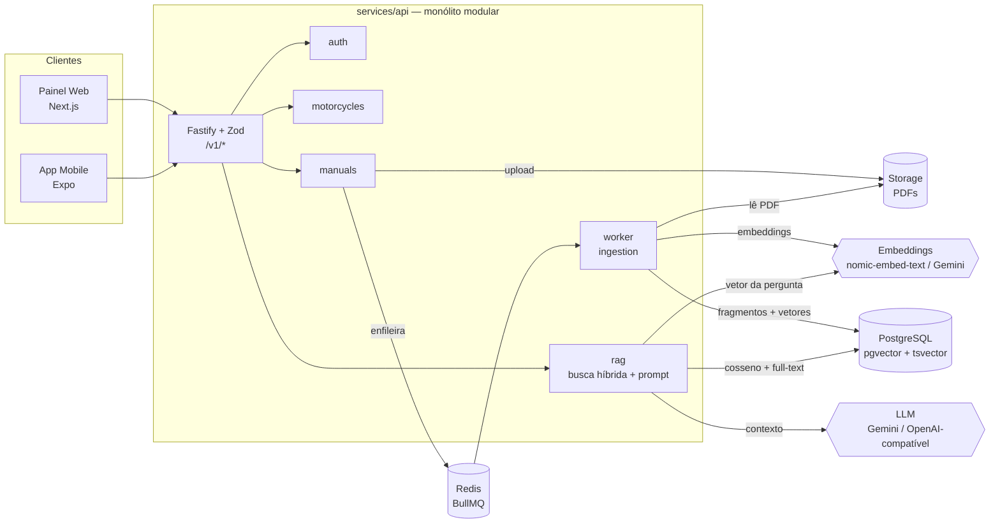

# Arquitetura do TorqueSpec

## Visão geral

### Fluxo de ingestão

1. `POST /v1/manuals` (admin) recebe o PDF em streaming (até 100 MB), valida a assinatura `%PDF-`, grava no storage e cria o manual com `status = pending`.
2. A API responde **202** e publica um job na fila `manual-ingestion` (BullMQ). O upload não espera a indexação.
3. O **worker** (processo separado, mesmo código) extrai o texto **página a página** (`unpdf`/pdf.js), fragmenta, gera embeddings em lotes de 32 e grava tudo em `manual_chunks` numa transação. O progresso vai para `manuals.progress` (o painel faz polling em `GET /v1/manuals/:id`).
4. Falhas ficam registradas em `manuals.error`; o job tem 3 tentativas com backoff exponencial. `POST /v1/manuals/:id/reindex` reprocessa.

### Fluxo de pergunta

1. `POST /v1/manuals/:id/ask` gera o embedding da pergunta.
2. Duas buscas em paralelo, restritas ao manual:
   - **vetorial**: `ORDER BY embedding <=> $query` (cosseno, índice HNSW);
   - **lexical**: `tsvector` com a configuração `pt_unaccent` (stemmer português + `unaccent`), ranqueada por `ts_rank_cd`.
3. Os rankings são fundidos com **Reciprocal Rank Fusion** (`k = 60`) e os `RAG_TOP_K` melhores fragmentos viram o contexto.
4. A LLM responde citando "pág. N". A API extrai as páginas citadas e **só mantém as que existem no contexto recuperado** — uma página inventada é descartada e, sem citações válidas, a resposta sai com `grounded: false`.
5. Pergunta, resposta, citações, modelo, tokens e latência são gravados em `queries` (histórico do usuário + métricas do painel).

## Decisões (ADRs curtos)

### ADR-001 — Monólito modular em vez de microsserviços
**Contexto:** a estrutura prevê `services/api` (core + auth) e `services/ai-engine` (RAG).
**Decisão:** começar com um único serviço Node/TypeScript organizado em módulos (`auth`, `motorcycles`, `manuals`, `ingestion`, `rag`, `admin`) que só se comunicam por interfaces. O RAG fica isolado em `src/modules/rag` + `src/modules/ingestion` e depende apenas das portas `EmbeddingProvider`, `LlmProvider` e `FileStorage`.
**Consequências:** um deploy, uma base de testes e transações locais. A extração para `services/ai-engine` (ex.: em Python/FastAPI para usar OCR, rerankers ou modelos locais) fica mecânica: os módulos de ingestão e RAG já não conhecem HTTP nem auth. O gatilho para extrair é precisar de bibliotecas que só existem em Python ou escalar a ingestão de forma independente.

### ADR-002 — PostgreSQL + pgvector como banco vetorial
**Decisão:** guardar vetores no mesmo Postgres dos dados relacionais.
**Por quê:** filtros por manual, `ON DELETE CASCADE`, transações e full-text no mesmo lugar; um serviço a menos para operar. Volume esperado (milhares de manuais × centenas de fragmentos) cabe com folga num índice HNSW.
**Trade-off:** o filtro `WHERE manual_id = ...` é aplicado depois da varredura HNSW; com muitos manuais, a busca pode trazer menos candidatos que `RAG_CANDIDATES`. Mitigações futuras: `hnsw.iterative_scan` (pgvector ≥ 0.8) ou particionamento por manual.

### ADR-003 — Busca híbrida com RRF
**Decisão:** combinar busca vetorial e full-text com Reciprocal Rank Fusion.
**Por quê:** embeddings entendem paráfrases ("aperto" ↔ "torque"), mas erram códigos exatos (`520VD2`, `DR8EA-N`, `90890-01135`), que são justamente o que mecânicos procuram. RRF funde rankings sem normalizar pontuações de escalas diferentes.
**Nota:** o README fala em BM25; o Postgres nativo oferece `ts_rank_cd` (frequência + proximidade), que cumpre o mesmo papel aqui. BM25 "de verdade" pode vir com `pg_search`/ParadeDB sem mudar a interface do `HybridRetriever`.

### ADR-004 — Fragmentos nunca atravessam páginas
**Decisão:** o chunker trabalha página a página (tamanho alvo 1200 caracteres, sobreposição 200, respeitando linhas e frases).
**Por quê:** a citação da página é a funcionalidade central do produto. Um fragmento que mistura duas páginas tornaria a citação ambígua.

### ADR-005 — Provedores de LLM/embeddings plugáveis
**Decisão:** interfaces `LlmProvider` e `EmbeddingProvider` com implementações `gemini`, `openai` (qualquer API compatível com `/chat/completions`: OpenAI, Groq, OpenRouter, Ollama…), `ollama` (embeddings `nomic-embed-text`) e `fake`.
**Por quê:** o requisito é trocar de LLM sem mudar código. O provedor `fake` (embeddings por feature hashing + "LLM" extrativa) roda o pipeline inteiro sem chave e sem custo — é o que os testes de integração e a CI usam.
**Restrição:** a coluna é `vector(768)`. Trocar para um modelo com outra dimensão exige migration + `reindex` dos manuais.

### ADR-006 — Contratos compartilhados com Zod
**Decisão:** `packages/shared-types` exporta schemas Zod; a API os usa para validar entrada/saída (via `fastify-type-provider-zod`) e gerar o OpenAPI em `/docs`; web e mobile importam os mesmos tipos.
**Por quê:** uma fonte da verdade para os DTOs; mudar um contrato quebra a compilação dos clientes em vez de quebrar em produção.

### ADR-007 — Ingestão assíncrona com BullMQ
**Decisão:** upload e indexação são separados por uma fila no Redis; o worker é um processo à parte (`dist/worker.js`, mesma imagem Docker).
**Por quê:** PDFs de 100 MB levam minutos para extrair e vetorizar; a API não pode segurar a conexão nem perder trabalho se reiniciar. Retentativas e backoff vêm de graça.

## Segurança

- Senhas com bcrypt (custo 12); login com tempo constante mesmo para e-mail inexistente.
- JWT com papel (`admin` / `mechanic`); rotas de escrita e inspeção de fragmentos exigem `admin`.
- Rate limit em login/registro (10/min) e em perguntas (`ASK_RATE_LIMIT_PER_MINUTE`).
- Upload: limite de tamanho, checagem de assinatura do PDF, nome do arquivo no disco sempre gerado pelo servidor.
- Prompt: o conteúdo do manual vai delimitado em `<contexto>` e o system prompt instrui a tratá-lo como dado, não como instrução; páginas citadas fora do contexto são descartadas.
- Busca lexical: o texto do usuário é reduzido a letras/dígitos antes de virar `tsquery` e sempre passa como parâmetro.
